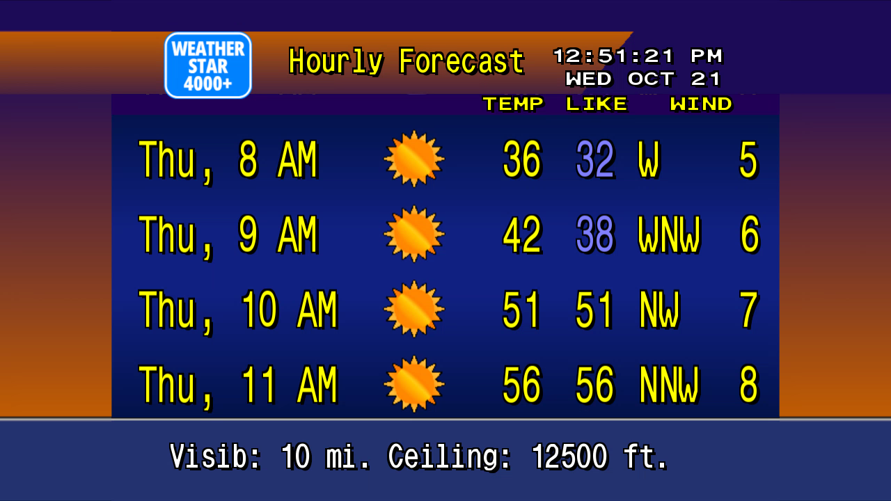
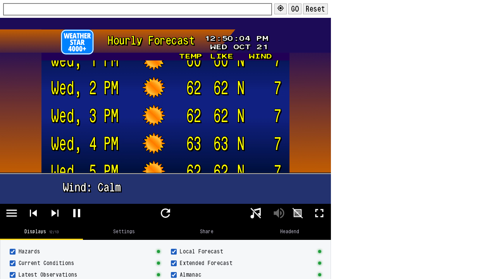

# WeatherStar 4000+ as a Jellyfin Live TV channel

Put the retro Weather Channel "Local on the 8s" look on your TV as a 24/7 channel in Jellyfin's
Live TV guide, using [WeatherStar 4000+ (ws4kp)](https://github.com/netbymatt/ws4kp) and
[ws4channels](https://github.com/rice9797/ws4channels).



The basic setup is already covered elsewhere (the ws4channels README,
[How-To Geek](https://www.howtogeek.com/i-brought-back-the-1980s-weather-channel-by-self-hosting-it/)).
This guide is mostly about **the four things that go wrong in Jellyfin** and how to fix them:

| Symptom | Cause | Fix |
|---|---|---|
| Video runs slow, buffers, then races to catch up | `FRAME_RATE` is higher than your host can capture | [Pick FRAME_RATE](#4-pick-frame_rate-the-step-everyone-skips) |
| Stream shows the whole web page, menus and all | Permalink has `kiosk=false` | [Step 2](#2-make-a-permalink-and-set-kiosktrue) |
| Channel has no number in Jellyfin | Playlist uses a tag Jellyfin doesn't read | [Channel number](#channel-number) |
| Channel plays but the guide is empty | Usually just the guide refresh | [Step 5](#5-add-it-to-jellyfin) |

## Tested with

| Component | Version |
|---|---|
| ws4kp | 8.0.1 (`ghcr.io/netbymatt/ws4kp:8.0.1`) |
| ws4channels | 2.5.1 (`ghcr.io/rice9797/ws4channels@sha256:a448e735…`) |
| Jellyfin | 10.11.11 |
| Clients | Jellyfin web (desktop browser), Wholphin on Android TV |
| Host | Ubuntu 24.04 VM, x86_64, 4 vCPU, Docker 29 / Compose v2 |

Tested 2026-10-21. Both projects move fast, so check the versions.

## How it works

```
ws4kp (web page, :8089)
   │  headless Chrome takes screenshots of it
   ▼
ws4channels (Chrome + ffmpeg → HLS H.264/AAC 1280×720, :9798)
   │  /playlist.m3u   /guide.xml
   ▼
Jellyfin Live TV  (M3U tuner + XMLTV guide)
```

ws4kp is just a web page. Jellyfin can't play a web page, so ws4channels takes screenshots of it,
encodes them into a live stream, and gives Jellyfin a playlist and a guide.

## Requirements and limits

- **US locations only.** ws4kp uses NOAA's `api.weather.gov`. (There is a
  [ws4kp-international](https://github.com/mwood77/ws4kp-international) fork; not tested here.)
- **x86_64 only.** ws4channels has no ARM image.
- **About one CPU core, all the time.** It encodes even when nobody is watching. It uses about 330 MB of RAM.
- **No hardware encoding.** It's software `libx264` only.

## 1. Start ws4kp

Use [`docker-compose.example.yml`](docker-compose.example.yml). Start ws4kp alone first:

```sh
docker compose up -d ws4kp
```

Open `http://<docker-host-ip>:8089`, enter your ZIP code, and set it up the way you want it to
look on TV: which screens to show, wide screen, scan lines, units, custom scrolling text.

## 2. Make a permalink, and set `kiosk=true`

On the page, open **Share** and copy the permalink. It holds every setting, including location.

**Then edit the link by hand and change `kiosk=false` to `kiosk=true`.** Don't tick Kiosk on the
page to do this: kiosk mode hides the menus, including the Share button you need.

Why this matters: ws4channels has code that turns on kiosk mode and the wide view, but **it only runs
when `PERMALINK_URL` is not set**. With a permalink, it loads your link exactly as written. So with
`kiosk=false`, your channel shows the whole web page:



The same applies to `VIEW_MODE`: with a permalink it's ignored, so set the view (for example
`viewMode=wide`) in the permalink.

## 3. Start ws4channels

Put your permalink in `PERMALINK_URL` in **single quotes** (it's full of `&` and `%`), then:

```sh
docker compose up -d ws4channels
docker logs -f ws4channels     # look for "Started FFmpeg"
```

Check that it's serving:

```sh
curl http://<docker-host-ip>:9798/playlist.m3u
curl http://<docker-host-ip>:9798/health
```

## 4. Pick FRAME_RATE (the step everyone skips)

ws4channels takes **one screenshot at a time**, then hands each one to ffmpeg, which is told the
frames arrive at `FRAME_RATE` per second. If screenshots can't keep up, ffmpeg still labels the
frames at `FRAME_RATE`, so **the video runs slower than real time**. Players then stall and race
to catch up. This is the "stuttering / falling behind" known issue in the ws4channels README and
[issue #45](https://github.com/rice9797/ws4channels/issues/45).

Adding CPU doesn't fix it past a point. Each screenshot takes a fixed amount of time, so capture
can't use more than about one core. What I measured on a 4 vCPU VM:

| `cpus` limit | `FRAME_RATE` | Avg screenshot | Real capture rate | Video vs. clock |
|---|---|---|---|---|
| 1.0 | 10 (default) | ~224 ms | ~3.4 fps | about 1/3 speed, broken |
| 2.0 | 10 (default) | ~144 ms | ~4.6 fps | about 1/2 speed, broken |
| 2.0 | **4** | ~145 ms | 4 fps | **120.5 s of video per 121 s, 0 stalls** |

**How to check yours:** read `/health` twice, 60 seconds apart:

```sh
curl -s http://<docker-host-ip>:9798/health; sleep 60; curl -s http://<docker-host-ip>:9798/health
```

- `lastFfmpegTimemark` should advance by about **60 seconds**. If it advances less, lower `FRAME_RATE`.
- `framesSkippedOverlap` should stay near 0. If it keeps growing, screenshots are overlapping, so lower `FRAME_RATE`.
- To find a starting value: `1000 / avgScreenshotMs`, rounded **down**, then subtract one.

4 fps sounds low, but WeatherStar is mostly still pages; only the scrolling text at the bottom
looks a little choppy.

## 5. Add it to Jellyfin

1. **Dashboard → Live TV → Tuner Devices → +**: type **M3U Tuner**, URL
   `http://<docker-host-ip>:9798/playlist.m3u`. Save.
2. **TV Guide Data Providers → +**: type **XMLTV**, URL `http://<docker-host-ip>:9798/guide.xml`. Save.
3. **Scheduled Tasks → Refresh Guide.** Give it a minute. In my case the channel showed under
   *Channels* before it showed in the *Guide*.

**You don't need Map Channels.** The playlist says `tvg-id="weatherStar4000"` and the guide says
`channel id="WS4000"`, so the IDs don't match. But when IDs don't match, Jellyfin falls back to
matching by channel name, and both sides call it `WeatherStar 4000`. You can confirm it in the
Jellyfin log:

```
ListingsManager: Found epg channel in "XmlTV" null "WeatherStar 4000" "WS4000"
```

The guide shows one-hour "Local Weather" blocks.

## Channel number

In 2.5.1 the playlist always says `tvg-channel-no="275"`, but **Jellyfin only reads `tvg-chno`**
([M3uParser.cs](https://github.com/jellyfin/jellyfin/blob/master/src/Jellyfin.LiveTv/TunerHosts/M3uParser.cs)),
so the channel arrives **with no number**. The `CHANNEL_NUMBER` variable in the README isn't used
anywhere in 2.5.1's code.

That can be fine: an unnumbered channel sorted to the **top** of the guide in both the Jellyfin web
client and Wholphin. If you want a real number, host your own playlist and point the M3U tuner at
it. The stream URL doesn't change:

```
#EXTM3U
#EXTINF:-1 tvg-id="WS4000" tvg-chno="1" tvg-logo="http://<docker-host-ip>:9798/logo/ws4000.png",WeatherStar 4000
http://<docker-host-ip>:9798/stream/stream.m3u8
```

Jellyfin treats `0` and `-1` as "no number", so you can't use channel 0. A decimal like
`0.1` works if you want it ahead of channel 1. *(I've confirmed this from Jellyfin's source but haven't run it.)*

## Updating

ws4channels only publishes `:latest`, and its changelog says updates aren't always tested. Pin
the digest (as the example file does). To update, pull, test on a second port, and only then change the pin.

## Credits

- [netbymatt/ws4kp](https://github.com/netbymatt/ws4kp) (MIT): WeatherStar 4000+.
- [rice9797/ws4channels](https://github.com/rice9797/ws4channels): the screenshot-to-stream bridge.
  It's built for Channels DVR; this guide covers the Jellyfin side.
- [Channels community thread](https://community.getchannels.com/t/weatherstar-4000/43461), where most of the original testing happened.

Built and tested on my homelab by [@blackcharger](https://github.com/blackcharger), with help from
Claude (Anthropic) for debugging and drafting this guide.

## License

This guide and example file are licensed under [CC BY 4.0](LICENSE): share or adapt them with credit.
ws4kp and ws4channels are separate projects under their own terms.
